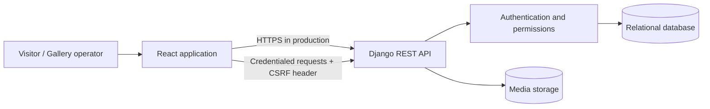

# ArtGallery

ArtGallery is a full-stack gallery and museum management application. It gives gallery operators a private workspace for managing their collections and lets visitors explore publicly shared artwork with images, descriptions, audio, and video.

The application is built with **React 18, Vite, Django 5.2, and Django REST Framework**. It is structured as a frontend application backed by a REST API and a relational database.

## Visual showcase


[Browse application screenshots and the recorded walkthrough](docs/showcase/README.md).

## Core capabilities

- Public gallery directory and gallery profiles.
- Public artwork browsing with image, text, audio, and video content.
- Authenticated gallery workspace for creating, editing, and deleting owned artwork.
- Gallery profile management and private target-file management.
- Cookie-based authentication using expiring HttpOnly sessions.
- CSRF protection for unsafe cookie-authenticated requests.
- English/Persian interface translations.
- Automated backend, frontend, and browser end-to-end checks.

## Architecture

The repository is organized into two independently runnable applications:

```text
art-gallery/
├── backend/                 # Django project and REST API
│   ├── backend/              # Settings, URL routing, ASGI/WSGI
│   └── artgallery/           # Models, serializers, views, auth, permissions
├── frontend/                # React + Vite single-page application
│   ├── src/Components/       # Pages, layouts, and protected routes
│   ├── src/api.js            # Shared credentialed API client + CSRF handling
│   └── e2e/                  # Playwright browser workflow
└── .github/workflows/        # CI checks
```

### Request and authentication flow



- Public reads are available for the gallery directory, gallery profiles, and artwork.
- Gallery write operations are authenticated and artwork mutations are restricted to the owning gallery.
- Browser authentication uses an expiring `HttpOnly` cookie. The raw session token is not exposed to JavaScript or stored in browser local storage.
- The API stores a SHA-256 digest of the session token and checks its expiry on each authenticated request.
- Cookie-authenticated unsafe requests require a CSRF token obtained from `/api/auth/csrf/`.
- Target-file API records are scoped to the authenticated gallery. Direct media URLs are a separate storage concern; a production media server or object store must deny public access to the `target_file/` directory.

## Technology

| Area | Technology |
|---|---|
| Frontend | React 18, React Router, Vite |
| API | Python, Django 5.2 LTS, Django REST Framework |
| Database | SQLite for local development; PostgreSQL required when debug mode is disabled |
| Media handling | Pillow and Django file storage |
| Browser tests | Playwright with Chromium |
| CI | GitHub Actions |

## Run locally

### Prerequisites

- Python 3.10 or newer
- Node.js 22 or newer
- npm

### 1. Start the backend

```bash
cd backend
python -m venv .venv

# Linux / macOS
source .venv/bin/activate

# Windows PowerShell
# .venv\Scripts\Activate.ps1

pip install -r requirements.txt
cp .env.example .env
python manage.py migrate
python manage.py runserver
```

The API runs at `http://localhost:8000`. Local development uses SQLite by default. The backend reads configuration from environment variables and an optional `backend/.env` file.

### 2. Start the frontend

In a second terminal:

```bash
cd frontend
npm ci
npm run dev
```

The Vite development server runs at `http://localhost:5173`. By default, the frontend connects to `http://localhost:8000`.

If the API runs elsewhere, create `frontend/.env`:

```dotenv
VITE_API_BASE_URL=http://localhost:8000
```

The optional scanner integration can be configured with `VITE_SCANNER_URL` when a compatible scanner service is available.

## API overview

The API retains the existing `gallaries` spelling in its URL paths for compatibility.

| Method | Endpoint | Access |
|---|---|---|
| GET | `/api/gallaries/` | Public gallery directory |
| POST | `/api/gallaries/` | Public registration (CSRF protected) |
| GET | `/api/gallaries/{id}/` | Public gallery profile |
| PATCH / PUT | `/api/gallaries/{id}/` | Owning gallery |
| GET | `/api/items/` | Public artwork collection |
| POST | `/api/items/` | Authenticated gallery |
| GET | `/api/items/{id}/` | Public artwork |
| PATCH / PUT / DELETE | `/api/items/{id}/` | Owning gallery |
| GET / POST | `/api/targetfiles/` | Authenticated gallery; list is owner-scoped |
| GET | `/api/targetfiles/{id}/` | Owning gallery only |
| PUT / PATCH / DELETE | `/api/targetfiles/{id}/` | Owning gallery only |
| GET | `/api/auth/csrf/` | Public CSRF bootstrap |
| POST | `/api/auth/login/` | Public login (CSRF protected) |
| POST | `/api/auth/logout/` | Authenticated gallery |

## Security design

- Gallery passwords are stored using Django password hashes and are write-only at the serializer boundary.
- Session tokens are generated with a cryptographically secure token generator; only SHA-256 digests are stored in the database.
- Sessions expire after the configured lifetime (14 days by default). The current account model supports one active session token per gallery, so a new login replaces the previous session.
- Browser sessions use HttpOnly cookies; secure-cookie behavior is enabled outside debug mode.
- CSRF validation is enforced for login, registration, and cookie-authenticated unsafe requests.
- Public gallery responses omit email, address, and contact details.
- Artwork create/update/delete operations enforce gallery ownership.
- Target-file endpoints only return records belonging to the authenticated gallery.
- Upload limits are enforced by the API: artwork images 10 MB, gallery profile images 5 MB, audio 25 MB, video 100 MB, and target files 50 MB. Extension allowlists are used for audio/video uploads. These checks are defense-in-depth, not malware scanning or proof of file content.

### Production boundary

This repository has **not been deployed or validated against a hosting provider**. Before a production deployment, configure a unique secret key, PostgreSQL, explicit allowed hosts, exact CORS/CSRF origins, HTTPS and trusted proxy settings, persistent media storage, request-body limits, backups, and private delivery for `target_file/` media. Do not expose the target-file storage directory through a public static-media server. See `backend/.env.example` for the available settings.

## Quality checks

### Backend

```bash
cd backend
python manage.py check
python manage.py makemigrations --check --dry-run
python manage.py test
```

### Frontend

```bash
cd frontend
npm ci
npm audit
npm run lint
npm run build
```

### Browser end-to-end workflow

The Playwright test in `frontend/e2e/test_gallery_workflow.py` exercises the main browser lifecycle: registration, gallery setup, session-cookie behavior, artwork upload and CRUD, logout/login, invalid credentials, and browser runtime-error checks.

GitHub Actions runs backend checks/tests, frontend dependency audit/lint/build, and the Chromium end-to-end workflow for pull requests and pushes to `main`.

## Project status

This repository is maintained as a portfolio project. Automated checks cover the current development workflow, but hosting-specific deployment behavior, production media delivery, backups, and operational monitoring have not been verified because the application is not currently deployed.
